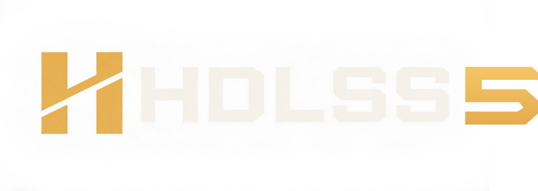
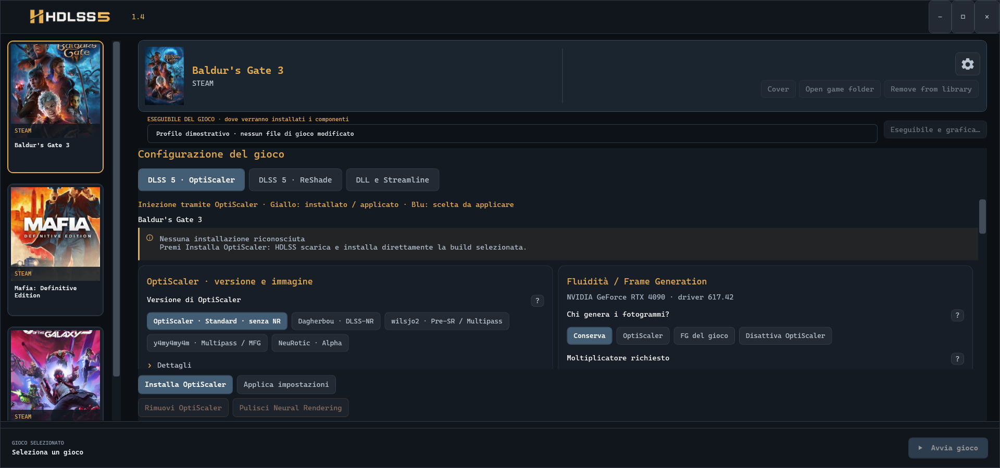
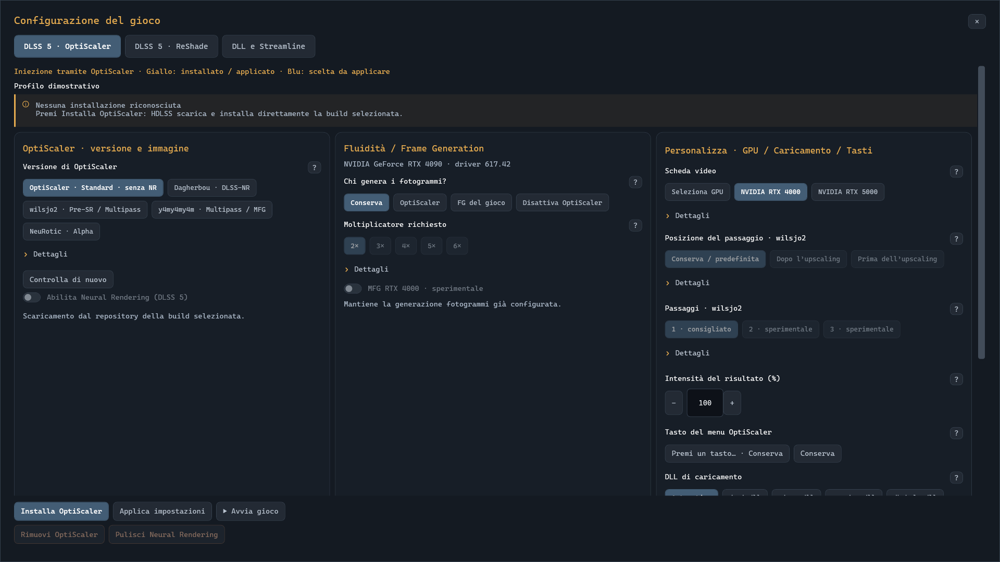
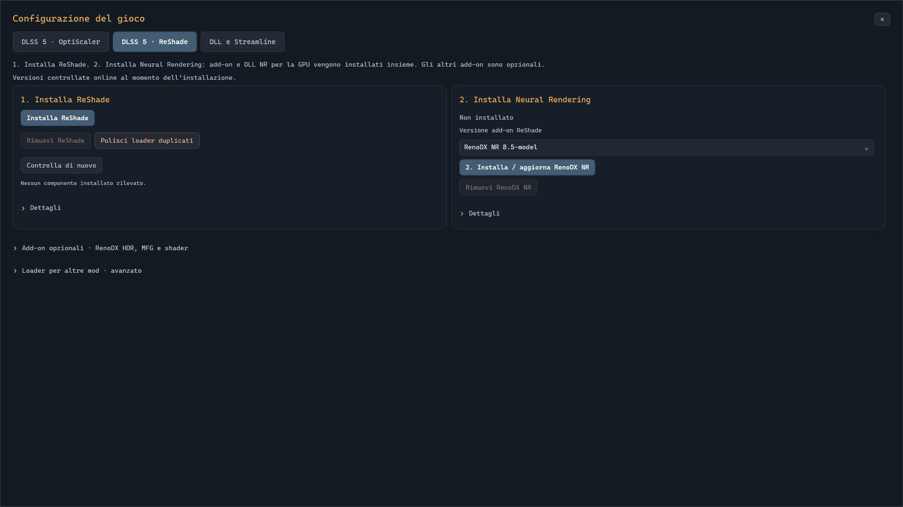
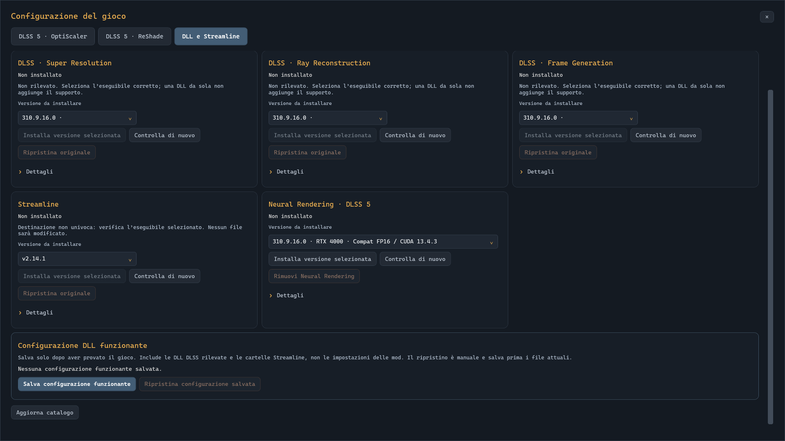

# HDLSS5

**Portable Windows manager for OptiScaler, ReShade, Neural Rendering, HDR add-ons and graphics DLLs.**

[Download HDLSS5 1.4](https://github.com/giorgiobascialla-hub/Ourze/releases/tag/v1.4) · [Changelog](CHANGELOG.md)



HDLSS5 brings component installation, version selection, update checks and recovery into one interface. Select a game from the cover library, let the app detect its executable and manage supported graphics components from three consistent categories. This is an independent community project; community Neural Rendering injectors are not official NVIDIA integrations.

## New in 1.4

Two-step ReShade → Neural Rendering installation includes automatic GPU-specific model selection. Optional add-ons are grouped separately. General settings use a gear menu; game actions stay in the game header. Verified download cache is reused and trimmed at startup without removing backups. See the [full changelog](CHANGELOG.md).

## Features

### Library and workspace
- Discover Steam and Xbox / Game Pass installations or add an executable manually.
- Browse game covers in the side library, search and select a game without leaving the workspace.
- Keep the selected category and detail sections when switching games.
- Responsive component cards, visible primary actions, smooth library scrolling, themes and six interface languages: Italian, English, Spanish, French, German and Portuguese.
- Internal help, changelog, activity log and technical details.

### OptiScaler
- Install official OptiScaler Standard without Neural Rendering, or choose supported community builds including NeuRotic.
- Configure available Neural Rendering quality, style and build-specific parameters.
- Configure supported Frame Generation modes and multipliers, with hardware/build limitations shown in the app.
- Keep installation, apply-settings, removal and Neural Rendering cleanup actions accessible.

### ReShade and add-ons
- Install supported ReShade builds with add-on support.
- Manage RenoDX HDR and ReShade Neural Rendering, including recognized manual installations and local imports.
- Component-specific update and removal controls.
- Lilium HDR tools and CAS sharpening packages.
- MFG Unlock management, ASI Loader and conditional UE4SS tools.
- REFramework installation for recognized RE Engine executables, with supported legacy variants and loader conflict checks.
- Conditional HDR configuration where a supported profile exists.

### DLL and Streamline management
- Separate Super Resolution, Ray Reconstruction, Frame Generation and Neural Rendering model selection.
- Show the full update destination and the installed version of the selected copy.
- Manage Streamline per detected folder; multiple locations are not silently treated as one installation.
- Online catalogs, local imports and cached downloads where supported.
- Compare files and preserve backups; detecting a file does not prove the game loads it.
- Save a working DLL configuration and restore it manually after testing.

### Updates and recovery
- Verify package identity and published hashes where available.
- Preserve supported managed backups and recovery information.
- Distinguish unavailable update checks from confirmed updates.
- Verify large RenoDX downloads with bounded size/time checks and x64/hash validation.

## Screenshots — version 1.4

Rendered from the application using a demonstration profile. Components and available actions depend on the selected installation.

### Cover library and game workspace


### OptiScaler


### ReShade and add-ons


### DLLs and Streamline


## Start and update

Windows x64 and .NET Framework 4.8 are required. Download **HDLSS5-Portable-1.4.zip**, extract it into a writable folder and run **HDLSS5.exe**. Version 1.4 includes guided GPU-specific Neural Rendering installation, verified cache management and the reorganized interface. No Python or developer SDK is required.

For an existing installation: close the app, extract the updated package into its folder, preserve `data`, `data-location.txt` and all backups, and remove the old `HDLSS.exe` from that application folder. Update any shortcuts to `HDLSS5.exe`. The name change does not require migrating your saved data. Do not run old and new copies together.

Select a game, let the app detect its executable, then choose **OptiScaler**, **ReShade** or **DLL and Streamline**. Close the game before changing its files.

## Compatibility

Support depends on the game integration, GPU, driver, display and component. Replacing DLLs does not add features an application does not implement. Protected installations and anti-cheat may block modifications. Verify effects and performance in game. MFG Unlock requires compatible native Frame Generation and full add-on ReShade; it does not add native FG support. Community features may be experimental.

The application does not prevent drivers or launchers from changing game files and does not automatically reapply saved files. Real-time game-text translation is not included.

## Build

```powershell
New-Item -ItemType Directory -Force dist | Out-Null
powershell -ExecutionPolicy Bypass -File ./src/build.ps1 -Output ./dist/HDLSS5.exe
```

## Support and credits

Report app version, Windows version, GPU/driver, selected component and expected versus actual behavior. Remove private paths from logs before sharing; do not upload game files or backups.

HDLSS5 is not affiliated with NVIDIA, Valve, Microsoft, ReShade, RenoDX or OptiScaler authors. Third-party components retain their authors’ terms. The portable package includes two GPU-specific NR 310.9.16.0 models and the 8.5-model/ShortFuse add-on choices; other component downloads are obtained separately. Public source availability alone does not grant a reuse license. Third-party trademarks and artwork belong to their owners.

[Component sources](docs/SOURCES.txt) · [Optional donation](https://paypal.me/Ourze)

### Antivirus report
Windows Defender reported `Trojan:Win32/Bearfoos.A!ml` on an earlier renamed build and its unchanged rebuild. Version 1.4 has not received Microsoft clearance. The owner restored the file and functional checks passed. This does not independently establish a false positive. No antivirus exclusions or protection changes are included in HDLSS5.
